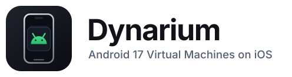

<p align="center">
  <picture>
    <source media="(prefers-color-scheme: dark)" srcset="../assets/dynarium-logo-dark.svg">
    <source media="(prefers-color-scheme: light)" srcset="../assets/dynarium-logo-light.svg">
    
  </picture>
</p>

<p align="center">
  <a href="https://github.com/userlethekhoi/dynarium/releases"></a>
  
  <a href="../../LICENSE"></a>
</p>

<p align="center">
  <a href="../../README.md">English</a> ·
  <a href="README.vi.md">Tiếng Việt</a> ·
  <a href="README.zh-CN.md">简体中文</a> ·
  <a href="README.ja.md">日本語</a> ·
  <strong>한국어</strong> ·
  <a href="README.es.md">Español</a>
</p>

---

Dynarium은 iPhone과 iPad(**iOS 16.0 – iOS 27+**)를 위한 멀티 VM Android 하이퍼바이저입니다. User-Mode Linux(`6.18 LTS`)와 [`imxieyi/Kernarium`](https://github.com/imxieyi/Kernarium) 기반 Gadget Engine을 통해 **Android 17(LineageOS 24)**을 직접 실행합니다.

약 1 GB짜리 시스템 이미지를 `.ipa` 안에 고정으로 넣는 대신 VMware와 같은 분리 구조를 택했습니다. 앱 본체는 ~22–38 MiB로 가볍게 유지하고, 필요할 때 ROM을 다운로드하거나 가져와 읽기 전용 `system.img`를 APFS Copy-on-Write(`clonefile`)로 공유하는 여러 가상 머신을 운영할 수 있습니다.

## 다운로드 및 버전 선택

GitHub Releases에서 `ldid` 메모리 확장 권한이 포함된 미서명 `.ipa` 2종을 배포합니다.

| 패키지 파일 | 권장 기기 | 그래픽 백엔드 | 크기 |
| :--- | :--- | :--- | :--- |
| `Dynarium-v<version>-Metal4-iOS26.ipa` | **iOS 26 / 27+ 권장** (A14 / M1 이상) | 하드웨어 Vulkan 1.4 / GLES 3.2 (`KosmicKrisp + Mesa Zink`) | ~22 MiB |
| `Dynarium-v<version>.ipa` | **iOS 16.0 – 27+ 범용** (모든 Apple Silicon) | CPU `Mesa softpipe` (`DRAW_USE_LLVM=0`, JIT 불필요); JIT 연결 시 자동 `llvmpipe` 전환 | ~38 MiB |

[Releases 페이지](https://github.com/userlethekhoi/dynarium/releases)에서 `.ipa` 파일과 `SHA256SUMS.txt`를 받을 수 있습니다.

## 빠른 시작

1. **TrollStore**, **AltStore**, 또는 **SideStore**로 iOS 버전에 맞는 `.ipa`를 설치합니다.
2. **ROM(Kho ROM)** 탭에서 원탭으로 LineageOS 24(Android 17)를 받거나, URL 또는 파일 앱의 `.tar.gz` / `.tar.zst` 아카이브를 가져옵니다.
3. **VM(Máy ảo)** 탭에서 **+**를 눌러 가상 머신을 생성하고(기기 `os_proc_available_memory()` 기준 자동 최적화), 실행 버튼을 누릅니다.
4. 실행 중 하단 플로팅 HUD에서 시리얼 콘솔, 키보드, `.apk` / 분할 `.apks` / `.apkm` 설치, PIP(화면 속 화면), **AFK 절전 모드**를 사용할 수 있습니다.

## 주요 기능

- **ROM 분리 및 APFS 즉시 복제:** `.tar.gz`, `.tar.zst`, `.tar` 이미지를 희소 공간 건너뛰기(`F_PUNCHHOLE`) 및 SHA-256 검증과 함께 스트리밍 해제합니다. VM 복제는 APFS `clonefile`을 사용하여 초기 추가 저장 공간을 거의 차지하지 않습니다.
- **Anti-Jetsam 메모리 자동 튜닝:** 실행 시 프로세스 메모리 한도를 읽어 게스트 RAM, vCPU 수, 1x/Retina 배율을 자동으로 맞춥니다. 기존 VM 설정이 한도를 넘길 위험이 있으면 시작 전 원탭 안전 조정 안내를 띄웁니다.
- **실시간 부팅 단계 표시 및 크래시 진단:** 첫 `data.img` 초기화 동안 빈 검은 화면 대신 4단계 커널/Android 부팅 상태와 경과 시간을 보여줍니다. 이전 실행이 iOS에 의해 종료된 경우 `session.record`를 해석해 원인을 안내합니다.
- **VSOCK ADB 기반 APK 및 Split APK 설치:** iOS Keychain에 VM별로 보관되는 RSA-2048 키로 내부 VSOCK(`port 5555`) ADB에 바로 연결합니다. 단일 `.apk`뿐 아니라 `.apks`, `.apkm`, `.zip` 분할 설치(`pm install-create`)와 Wi-Fi ADB 포워딩도 지원합니다.
- **PIP 및 AFK 에코 모드:** iOS 16+ 호환 `AVSampleBufferDisplayLayer` PIP와 백그라운드 스로틀링, 페이지 캐시 정리, OLED 보호용 트루 블랙(`#000000`) 오버레이를 제공합니다.

## 참고 및 제한 사항

- **첫 부팅 소요 시간:** 새 가상 머신의 첫 실행에서는 `f2fs` `data.img` 생성 및 포맷에 약 **45–90초**가 걸린 뒤 Android 부팅 화면이 나타납니다.
- **무료 Apple ID 사이드로드 한도:** `increased-memory-limit` 권한이 제거되는 서명 환경이나 4 GiB RAM 기기에서는 프로세스 상한이 약 `2.0–2.3 GiB`로 제한됩니다. 이 경우 Retina를 끄고 게스트 RAM을 `1 GiB`로 유지하는 것이 안전합니다.
- **iOS 26 / 27+ 사용자는 Metal 4 빌드 권장:** A14 / M1 이상 기기에서는 CPU 소프트웨어 렌더러보다 `Metal4-iOS26` 빌드가 훨씬 부드럽고 호스트 RAM 소모도 적습니다.

## macOS에서 직접 빌드하기 (XcodeGen)

1. `deps-ios16-latest` 릴리스의 사전 빌드 의존성을 `.build/dependencies`에 풀거나 `dependencies/build-ios-*.sh` 및 `dependencies/build-apple-gpu.sh`를 실행합니다.
2. `KernariumRuntime` 빌드:
   ```sh
   cmake --preset kernarium-ios-device-android
   cmake --build --preset kernarium-ios-device-android
   ```
3. XCFrameworks 패키징 (`--tier ios16-universal` 또는 `--tier ios26-metal4`):
   ```sh
   ./Dynarium/scripts/package-dynarium-frameworks.sh --tier ios16-universal
   ```
4. `Dynarium/project.yml`에서 XcodeGen으로 프로젝트 생성:
   ```sh
   (CDPATH= cd -- Dynarium && xcodegen generate)
   ```

## 크레딧 및 라이선스

Dynarium은 Yi Xie의 [`imxieyi/Kernarium`](https://github.com/imxieyi/Kernarium) 코어 런타임 및 커널 작업 위에서 구축되었으며 [`ish-app/ish`](https://github.com/ish-app/ish)의 스레드 인터프리터 아이디어에서 영감을 얻었습니다. 전체 구성 요소 고지는 [`CREDITS.md`](../../CREDITS.md)를 참고하세요.

전체 코드는 **`GPL-2.0-or-later`**([`LICENSE`](../../LICENSE))로 배포되며, Android 게스트 오버레이 코드는 **`Apache-2.0`**, 서드파티 패치 라이선스는 [`LICENSES/`](../../LICENSES/)를 따릅니다.
